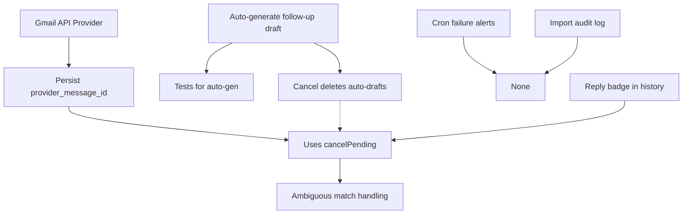

# PEPA — P1.0 Feature Gap Audit & Implementation Plan

**Date:** 2026-10-18  
**Branch:** `master` (HEAD `a1485eb`)  
**Test Suite:** 1,438 passing, 52 skipped  
**TypeScript:** Clean  
**Build:** Successful  
**P0 Status:** Closed — migration `20260101001100_fix_parent_trigger.sql` applied and verified in production Supabase

---

## 1. Executive Summary

This audit inspects the current PEPA implementation against the intended outreach workflow. P0 is closed: production database schema is verified, the parent-message trigger correctly normalizes recipients, and all regression tests pass.

The core workflow (ChatGPT → import → draft → manual send → history) is **verified working**. Three functional gaps remain for P1:

| Candidate | Status | Scope | Key Finding |
|-----------|--------|-------|-------------|
| **A. Follow-up draft generation** | PARTIALLY IMPLEMENTED | Small | Manual creation exists (`createFollowUp` action); automatic generation after send **not implemented** |
| **B. Reply detection** | NOT IMPLEMENTED | Medium | No inbound email mechanism; `provider_message_id` column exists but unused; Telegram webhook only handles callbacks |
| **C. ChatGPT→PEPA workflow** | VERIFIED WORKING | — | Import API, deep links, bulk paste, deduplication, quality gate all functional |
| **D. Operational visibility** | VERIFIED WORKING | — | Dashboard stats, follow-ups workspace, streak reminders, Telegram notifications all operational |

**No P1 implementation was performed during this audit.**

---

## 2. Current Architecture & Verified Working Features

### 2.1 Verified Working (Evidence: Code + Tests)

| Feature | Implementation | Test Coverage | Key Files |
|---------|---------------|---------------|-----------|
| **ChatGPT Import API** | `POST /api/import` with `IMPORT_SECRET` auth; validates payload, creates lead + draft (seq 0 + seq 1), returns deep link | `bulk-import.e2e.test.ts` (7 tests), `import-service.test.ts` | `src/app/api/import/route.ts`, `src/lib/services/import-service.ts` |
| **Import Deep Link** | `/import/[token]` resolves token, shows composer, `openImportInGmail` builds Gmail URLs | `bulk-import.e2e.test.ts`, `import-actions.test.ts` | `src/app/import/[token]/page.tsx`, `src/app/import-actions.ts` |
| **Bulk Paste Import** | `parseBulkEmails` → preview → `importBulkEmails` → `createDraft` per ready row | `bulk-import.e2e.test.ts` (3 batch scenarios: 5, 10, 30 emails) | `src/app/bulk-actions.ts`, `src/lib/import/bulk-emails.ts` |
| **Lead Deduplication** | DB unique index on `leads.email_normalized` (generated column via `normalize_email`); `findLeadByEmail` checks historical outreach | `lead-service.test.ts`, `bulk-import.e2e.test.ts` | `src/lib/services/lead-service.ts`, `supabase/migrations/20260101000000_init.sql` |
| **Draft Persistence** | `createDraft` upserts on `(lead_id, recipient_normalized, sequence_number)`; follow-ups created at seq 1,2… with `parent_message_id` | `outreach-service.test.ts`, `follow-up-sequence-service.test.ts` | `src/lib/services/outreach-service.ts` |
| **Manual Send Recording** | `recordOutreachSent` compare-and-set (`status IN ('draft','ready')` + `sent_at IS NULL`); calls `markFollowUpSent` to advance schedule | `actions.test.ts`, `draft-lead-management.e2e.test.ts` | `src/lib/services/outreach-service.ts:440-559` |
| **Quality Gate** | `evaluateStoredMessageQualityGate` runs at send time; checks recipient, identity, similarity, placeholders, AI artifacts, personalization evidence | `outreach-quality-gate.test.ts` (40+ tests) | `src/lib/outreach/quality-gate.ts`, `src/lib/services/outreach-quality-gate.ts` |
| **Follow-up Sequence** | `sequence_number` (0=initial, 1+=follow-up), `parent_message_id` chain; `createFollowUpDraft` allocates next slot via `MAX(sequence_number)+1` with unique constraint | `follow-up-sequence-service.test.ts` (33 tests) | `src/lib/services/follow-up-sequence-service.ts` |
| **Follow-up Scheduler** | Cron `GET /api/cron/followups` → `processDueFollowUps` → resolves target follow-up row → claims via `followup_notifications` ledger → sends Telegram with deep link | `follow-up-service.test.ts`, `followup-service.telegram-3min.test.ts` | `src/lib/services/follow-up-service.ts`, `src/app/api/cron/followups/route.ts` |
| **Telegram Notifications** | `TelegramProvider` implements `NotificationService`; sends `ActionNotification` with inline button (deep link); webhook validates secret + chat ID | `telegram/format.test.ts`, `webhook-auth.test.ts` | `src/lib/providers/telegram.ts`, `src/app/api/telegram/webhook/route.ts` |
| **Streak Reminders** | 19:00 Europe/Prague daily; 3× UTC cron for DST; per-day ledger in `streak_reminders`; derives streaks from `outreach_messages` (`status='sent'` + `sent_at`) | `streak-reminder-service.test.ts` (45 tests) | `src/lib/services/streak-reminder-service.ts`, `src/app/api/cron/streak-reminders/route.ts` |
| **Dashboard Stats** | `getOutreachStats` counts confirmed sends (`status='sent'` + `sent_at` not null) by day/week/month in Europe/Prague; `getOutreachStreaks` derives active days | `outreach-stats-service.test.ts`, `outreach-streak-service.test.ts` | `src/lib/services/outreach-stats-service.ts`, `src/lib/services/outreach-streak-service.ts` |
| **Follow-ups Workspace UI** | Lists only `sequence_number > 0`; groups due/scheduled/sent; "Gmail" opens compose, "Mark as sent" runs quality gate then `recordOutreachSent` | `follow-ups-client.tsx` (manual testable) | `src/components/follow-ups-client.tsx`, `src/app/follow-ups/page.tsx` |
| **Gmail Compose URLs** | `buildGmailComposeUrl` builds `mailto:` + web URLs; `openGmailComposeSmart` picks native iOS app or web; recipient/subject/body from DB row | `gmail-compose.test.ts`, `open-gmail-compose.test.ts` | `src/lib/outreach/gmail-compose.ts`, `src/lib/outreach/open-gmail-compose.ts` |

### 2.2 Database Schema (Verified via `verify-schema.sql` against Production)

- **12 migrations applied** (000–011)
- **Tables (7):** `leads`, `outreach_messages`, `action_tokens`, `followup_notifications`, `followup_notification_settings`, `historical_outreach`, `streak_reminders`
- **Views (2):** `due_followups`, `outreach_overview`
- **RLS enabled on all tables, zero policies, service-role only access**
- **Trigger `outreach_messages_parent_same_lead` verified:** calls `public.normalize_email(NEW.recipient_email)` in BEFORE trigger

---

## 3. Feature-by-Feature Status Table

| Feature | Status | Evidence | Missing / Risk |
|---------|--------|----------|----------------|
| ChatGPT import (single) | **VERIFIED WORKING** | `import-service.ts`, `api/import/route.ts`, 7 import tests | None |
| ChatGPT import (batch via paste) | **VERIFIED WORKING** | `bulk-actions.ts`, `bulk-import.e2e.test.ts` (5/10/30 email batches) | None |
| Lead deduplication | **VERIFIED WORKING** | DB unique index + `normalize_email` mirror; historical outreach guard | None |
| Draft creation (main + follow-ups) | **VERIFIED WORKING** | `createDraft` creates seq 0 + seq 1…N with parent links | None |
| Draft editing | **VERIFIED WORKING** | `updateMessage`, `saveImportedDraft`, `saveFollowUpDraft` upsert same slot | None |
| Manual send recording | **VERIFIED WORKING** | `recordOutreachSent` compare-and-set, idempotent, advances schedule | None |
| Quality gate at send | **VERIFIED WORKING** | Blocks on identity/similarity/placeholders/AI artifacts; warns on personalization | None |
| Follow-up manual creation | **VERIFIED WORKING** | `createFollowUp` action → `createFollowUpDraft` allocates next slot | None |
| Follow-up scheduling | **VERIFIED WORKING** | `markFollowUpSent` computes `next_followup_at` + `notification_due_at` via cadence | None |
| Follow-up notifications | **VERIFIED WORKING** | Cron processes due follow-ups, claims via ledger, sends Telegram with deep link | None |
| Telegram webhook | **VERIFIED WORKING** | Validates secret + chat ID; answers callbacks; no command processing | None |
| Streak reminders | **VERIFIED WORKING** | 19:00 Prague, 3× UTC cron, per-day ledger, derived streak metrics | None |
| Dashboard stats | **VERIFIED WORKING** | Sent today/week/month/total, initial vs follow-up breakdown, scan cap reported | None |
| Gmail compose URLs | **VERIFIED WORKING** | mailto + web + iOS native app (`googlegmail:///co?`) | iOS deep link unofficial |
| **Automatic follow-up draft generation** | **PARTIALLY IMPLEMENTED** | Manual `createFollowUp` exists; **no auto-generation after send** | See §4 |
| **Reply detection** | **NOT IMPLEMENTED** | `provider_message_id` column exists; no inbound mechanism; Telegram webhook ignores messages | See §5 |
| Email provider (Gmail API) | **NOT IMPLEMENTED** | `EmailProvider` interface + registry exist; no implementation | See §4/§5 dependency |
| Operational visibility | **VERIFIED WORKING** | Dashboard, follow-ups workspace, history, stats, streaks all functional | Minor: no failed-cron alerting |

---

## 4. P1 Candidate A — Follow-up Draft Generation

### 4.1 Current State

**Manual creation works.** The operator can:
1. Open follow-ups workspace (`/follow-ups`)
2. Click "Gmail" on a due follow-up → sends manually
3. Click "Mark as sent" → `recordOutreachSent` → `markFollowUpSent` advances `next_followup_at`
4. **But:** No follow-up draft is created automatically. The operator must manually create the next follow-up via the "Next follow-up" form in the follow-up detail panel (accessed via "View" link).

**Automatic generation does NOT exist.** When `recordOutreachSent` calls `markFollowUpSent`, it only:
- Increments `leads.followup_count`
- Sets `leads.next_followup_at` (email due date)
- Sets `leads.notification_due_at` (Telegram notification eligibility)

It does **not** create a draft row in `outreach_messages` for the next follow-up.

### 4.2 Implementation Gap

| Aspect | Current | Required for Auto-Generation |
|--------|---------|------------------------------|
| **Trigger** | Manual via UI (`createFollowUp` action) | Automatic in `markFollowUpSent` after successful send |
| **Content** | Operator writes subject/body in composer | Must copy from previous message or use template |
| **Sequence** | `createFollowUpDraft` allocates `MAX(seq)+1` with parent link | Same logic, called programmatically |
| **Idempotency** | Unique constraint on `(lead_id, recipient_normalized, sequence_number)` prevents duplicates | Same constraint protects auto-generation |
| **Editability** | Draft created as `status='draft'`, editable in composer | Same — operator reviews before sending |
| **Cancellation** | `followUpService.cancelPending` clears schedule + claimed notifications | Must also delete auto-generated draft on reply/cancellation |

### 4.3 Recommended Implementation (Small Scope)

**Location:** `src/lib/services/follow-up-service.ts` → `markFollowUpSent`

```typescript
// After advancing schedule, create the next follow-up draft if within cadence
const nextAttempt = attempt + 1;
if (isWithinCadence(nextAttempt, getFollowUpCadence())) {
  // Fetch the message that was just sent (anchor)
  const anchor = await getSupabaseAdmin()
    .from('outreach_messages')
    .select(MESSAGE_COLUMNS)
    .eq('lead_id', input.leadId)
    .eq('sequence_number', attempt)
    .maybeSingle();
  
  if (anchor.data) {
    await createFollowUpDraft({
      anchorMessageId: anchor.data.id,
      subject: anchor.data.subject ?? `Re: ${anchor.data.subject}`, // or template
      body: anchor.data.body ?? '', // operator must edit
    });
  }
}
```

**Acceptance Criteria:**
1. After operator clicks "Mark as sent" on sequence N, sequence N+1 draft exists (status='draft')
2. Draft has correct `parent_message_id`, `sequence_number = N+1`, same recipient
3. Draft is editable in follow-up detail panel before sending
4. If operator deletes draft, schedule remains (can recreate via "Next follow-up" form)
5. If lead replies (future), `cancelPending` should delete unsent auto-generated drafts

**Dependencies:** None (uses existing `createFollowUpDraft`)

**Tests Needed:**
- `markFollowUpSent` creates next follow-up draft when within cadence
- Draft content copied from anchor (subject prefixed "Re:", body preserved)
- No draft created past `MAX_FOLLOW_UPS` (3 by default)
- Idempotent: re-recording same send doesn't create duplicate draft
- `cancelPending` deletes unsent auto-generated drafts

**Risks:** Low — reuses existing battle-tested `createFollowUpDraft` logic.

---

## 5. P1 Candidate B — Reply Detection

### 5.1 Current State

| Component | Status | Notes |
|-----------|--------|-------|
| `provider_message_id` column | EXISTS | `outreach_messages.provider_message_id` (nullable, indexed) |
| `EmailProvider` interface | EXISTS | `send()` returns `providerMessageId` for persistence |
| Gmail API provider | NOT IMPLEMENTED | Registry empty; no OAuth credentials configured |
| Inbound webhook (Gmail push) | NOT IMPLEMENTED | No route, no Pub/Sub, no OAuth scope |
| IMAP/SMTP polling | NOT IMPLEMENTED | No infrastructure |
| Telegram webhook | IMPLEMENTED | Only validates secret + chat ID; handles callbacks; **ignores messages** |
| Reply matching logic | NOT IMPLEMENTED | No code to match inbound to `outreach_messages` |

**The Telegram webhook (`/api/telegram/webhook`) explicitly ignores non-callback updates:**
```typescript
// Commands and unrelated update types are acknowledged and ignored.
// The bot is a notification surface; it does not accept instructions.
return ok();
```

### 5.2 Implementation Gap (Medium Scope)

To detect replies, PEPA needs **one inbound email mechanism**. Options:

| Option | Pros | Cons | Effort |
|--------|------|------|--------|
| **Gmail API push (Pub/Sub)** | Real-time, official, includes `messageId` | Requires Google Cloud project, Pub/Sub topic, OAuth `gmail.readonly` + `pubsub`, domain verification | High |
| **Gmail API polling** | Simpler auth, no Pub/Sub | Latency (poll interval), quota-limited, misses real-time | Medium |
| **IMAP IDLE** | Works with any IMAP server | Complex connection management, not Gmail-specific | Medium |
| **Webhook from email forwarding** | Simple (forward to PEPA endpoint) | Requires operator to set up forwarding, parsing `References`/`In-Reply-To` headers | Low-Medium |

**Minimum Viable Implementation (Email Forwarding Webhook):**
1. Add `POST /api/email/inbound` endpoint (authenticated via shared secret)
2. Parse `In-Reply-To` and `References` headers → extract `provider_message_id`
3. Match to `outreach_messages` via unique index on `(provider, provider_message_id)`
4. On match: set lead `status='replied'`, call `followUpService.cancelPending(leadId)`
5. Handle ambiguous matches (multiple PEPA messages with same thread) safely

### 5.3 Recommended Approach

**Phase 1 (P1-B.1):** Implement Gmail API provider + polling (reuses OAuth from future send feature)
- Scope: Medium
- Enables: Actual sending + reply detection via same credentials
- Prerequisite for: Automatic follow-up cancellation on reply

**Phase 2 (P1-B.2):** Add inbound webhook for forwarded replies (lower barrier)
- Scope: Small-Medium
- Works without full Gmail API OAuth
- Can be operator-configured per lead

**Acceptance Criteria:**
1. Inbound reply matched to correct `outreach_messages` row via `provider_message_id`
2. Lead status set to `replied` (blocks future follow-ups)
3. `followUpService.cancelPending(leadId)` called → clears `next_followup_at`, deletes claimed notifications
4. Auto-generated unsent follow-up drafts (from P1-A) deleted
5. Ambiguous matches (multiple PEPA messages in thread) → flag for manual review, don't auto-cancel

**Dependencies:** P1-A (auto-generated drafts must be cancellable), Gmail API credentials (operator action)

**Risks:** Medium — matching logic must handle threading correctly; false positives cancel needed follow-ups.

---

## 6. P1 Candidate C — ChatGPT-to-PEPA Workflow Reliability

### 6.1 Current State: **VERIFIED WORKING**

All handoff paths tested and functional:

| Path | Verified | Evidence |
|------|----------|----------|
| Single import via API | ✅ | `import-service.ts:83-198`, `api/import/route.ts`, 7 import tests |
| Single import via deep link | ✅ | `/import/[token]` page, `import-actions.ts:67-98` |
| Bulk paste (10 emails) | ✅ | `bulk-import.e2e.test.ts` — 6 ready, 2 blocked, 1 dup, 1 needs_review |
| Bulk paste (30 emails) | ✅ | 23 ready, 7 already_contacted, chunked import (10/batch) |
| Duplicate handling | ✅ | Parser dedupes within paste; DB unique index prevents cross-session dupes |
| Historical block | ✅ | `historical_outreach` + domain guard blocks 2/10 in 10-email test |
| Unknown recipient → new lead | ✅ | `createDraft` creates lead on demand; no invented company name |
| Draft persistence | ✅ | Re-import returns `already_present`; manual edit refreshes same row |
| Quality gate integration | ✅ | Blocks `already_contacted` at import; warns at send |
| Manual send after import | ✅ | `openImportInGmail` builds URLs from stored row; `recordOutreachSent` records send |

### 6.2 Minor Gaps (Not Blocking)

| Gap | Impact | Fix Effort |
|-----|--------|------------|
| No batch size > 100 emails | Parser truncates at `MAX_BULK_EMAILS=100`, reports `truncated` count | None — by design |
| Import API fails closed without `IMPORT_SECRET` | No dev bypass; operator must configure secret | Documented in `api/import/route.ts:37-39` |
| No progress UI for chunked imports | Client handles chunking; server caps at 30 rows/request | Client-side only |
| No import history/log | Only current drafts visible | Would need new table + UI |

**No P1 work required.** The workflow is reliable for daily use.

---

## 7. Operational Visibility Gaps

### 7.1 Verified Working

| Surface | Metrics Provided | Access |
|---------|------------------|--------|
| **Dashboard** | Sent today/week/month/total, drafts count, leads count, pending follow-ups | `/` |
| **Follow-ups Workspace** | Due/scheduled/sent counts per lead; due date, initial sent date, sequence #, status | `/follow-ups` |
| **Outreach History** | Filterable table: lead, latest subject/status/date, message count, unsent flag | `/outreach` |
| **Drafts List** | All unsent sequence-0 drafts with lead info, quick open in Gmail | `/drafts` |
| **Telegram** | Follow-up due notifications (with deep link), 19:00 streak reminders | Telegram chat |
| **Cron Observability** | `/api/cron/followups` and `/api/cron/streak-reminders` return JSON counts | Vercel logs / manual curl |

### 7.2 Identified Gaps

| Gap | Severity | Recommendation |
|-----|----------|----------------|
| **Failed cron alerting** | Low | If `processDueFollowUps` returns `failed > 0`, no alert fires. Add `console.error` already logs; could add Telegram alert to operator. |
| **No import audit log** | Low | Import outcomes only in response; no persistent log of what was imported/skipped/failed. |
| **No lead-level reply indicator in history** | Medium (once reply detection exists) | `outreach_overview` view doesn't show `status='replied'` prominently. |

**No new analytics platform needed.** Existing surfaces cover operator needs.

---

## 8. Prioritized P1 Implementation Backlog

### P1-A (Core Workflow Completion)

| # | Item | Scope | Dependencies | Acceptance Criteria |
|---|------|-------|--------------|---------------------|
| **A1** | Auto-generate next follow-up draft in `markFollowUpSent` | Small | None (reuses `createFollowUpDraft`) | After "Mark as sent" on seq N, seq N+1 draft exists, editable, correct parent/recipient |
| **A2** | `cancelPending` deletes unsent auto-generated follow-up drafts | Small | A1 | On reply/cancellation, unsent auto-drafts removed; schedule cleared |
| **A3** | Test coverage for auto-generation + cancellation | Small | A1, A2 | Tests pass: draft created, content copied, idempotent, cancellable |

**Why P1-A first:** Completes the follow-up loop. Operator currently must manually create each follow-up; auto-generation removes this friction while preserving manual review.

---

### P1-B (Follow-up Management & Reply Handling)

| # | Item | Scope | Dependencies | Acceptance Criteria |
|---|------|-------|--------------|---------------------|
| **B1** | Implement `EmailProvider` (Gmail API) + register in registry | Medium | Google Cloud project, OAuth credentials (operator) | `getEmailProvider()` returns configured instance; `send()` returns `providerMessageId` |
| **B2** | Persist `provider` + `provider_message_id` in `recordOutreachSent` when provider used | Small | B1 | Sent row has `provider='gmail'`, `provider_message_id` set |
| **B3** | Inbound reply webhook (email forwarding) + match to `provider_message_id` | Medium | B1, B2 | Reply sets lead `status='replied'`, calls `cancelPending`, deletes unsent auto-drafts |
| **B4** | Ambiguous match handling (multiple PEPA messages in thread) | Small | B3 | Flags for manual review; doesn't auto-cancel |

**Why P1-B second:** Reply detection prevents wasted follow-ups and duplicate contacts. Requires Gmail API credentials (operator action).

---

### P1-C (Operational Improvements)

| # | Item | Scope | Dependencies | Acceptance Criteria |
|---|------|-------|--------------|---------------------|
| **C1** | Alert on failed cron runs (Telegram to operator) | Small | None | If `processDueFollowUps.failed > 0` or `processStreakReminder.failed`, send Telegram |
| **C2** | Import audit log (persistent record of batch outcomes) | Small | New table `import_audit` | Queryable history of imports: timestamp, batch size, ready/skipped/failed counts |
| **C3** | Reply indicator in `outreach_overview` / history table | Small | B3 | Lead row shows "Replied" badge when `status='replied'` |

**Why P1-C last:** Nice-to-have visibility; doesn't block core workflow.

---

## 9. Suggested Implementation Sequence & Dependencies



**Recommended Order:**
1. **A1 → A2 → A3** (2-3 days, no external deps)
2. **B1 → B2** (3-5 days, requires Google Cloud setup by operator)
3. **B3 → B4** (3-4 days, can use email forwarding initially)
4. **C1 → C2 → C3** (1-2 days each, independent)

---

## 10. Test Strategy & Acceptance Criteria

### Existing Test Coverage (Strong Foundation)
- **Unit/Integration:** 1,438 tests passing
- **Key Suites:** `follow-up-sequence-service.test.ts` (33), `bulk-import.e2e.test.ts` (7), `follow-up-service.test.ts`, `streak-reminder-service.test.ts` (45)
- **Patterns:** In-memory Supabase mocks, pure function tests, server action tests with mocked auth

### New Tests Required

| Feature | Test File | Scenarios |
|---------|-----------|-----------|
| A1 Auto-generation | `follow-up-service.auto-generation.test.ts` | Draft created after send; correct seq/parent/recipient; content copied; no draft past cadence; idempotent re-send |
| A2 Cancellation | `follow-up-service.cancel-auto.test.ts` | `cancelPending` deletes unsent auto-drafts; keeps manual drafts; clears schedule |
| B1 Gmail Provider | `providers/gmail.test.ts` | `isConfigured()` true with creds; `send()` calls Gmail API; returns `providerMessageId` |
| B3 Reply Webhook | `api/email/inbound.test.ts` | Parses `In-Reply-To`; matches `provider_message_id`; sets `replied`; calls `cancelPending`; handles ambiguous |
| C1 Cron Alerts | `cron-alerts.test.ts` | Failed cron triggers Telegram to operator |

### Acceptance Criteria Format
Each P1 item must have:
- ✅ Unit tests for pure logic
- ✅ Integration tests with in-memory Supabase mock
- ✅ TypeScript clean, lint clean, build passes
- ✅ No production mutation during test runs

---

## 11. Risks, Unknowns & Required Operator Decisions

| Risk | Likelihood | Impact | Mitigation |
|------|------------|--------|------------|
| **Gmail API OAuth setup complexity** | High | Blocks B1/B2/B3 | Start with email forwarding webhook (B3) as fallback; document Gmail API as Phase 2 |
| **Reply matching false positives** | Medium | Cancels needed follow-ups | Require `In-Reply-To` exact match to `provider_message_id`; ambiguous → manual review |
| **iOS Gmail deep link (`googlegmail:///co?`) unofficial** | Medium | May break on iOS update | Document as known limitation; fallback to `mailto:` always available |
| **Cron secret not set in preview** | Low | Preview deployments fail cron | Document `CRON_SECRET` requirement; fail-closed is correct for production |
| **Historical outreach domain guard over-blocks** | Low | Legitimate new contact at same domain blocked | Domain guard only triggers for non-shared providers; shared providers (gmail.com etc.) excluded |

### Required Operator Decisions

1. **Gmail API vs. Email Forwarding for Replies**
   - Gmail API: Full send + reply detection, but needs Google Cloud project, OAuth consent screen, domain verification
   - Email Forwarding: Lower barrier, operator sets up forward rule in Gmail; PEPA receives raw email at `/api/email/inbound`

2. **Follow-up Auto-Generation Content Strategy**
   - Copy previous message exactly (operator edits)
   - Prefix subject with "Re:" (current manual convention)
   - Use template variable (future)

3. **Maximum Follow-ups per Sequence**
   - Current: 3 (4, 7, 10 business days) via `FOLLOW_UP_CADENCE_DAYS`
   - Configurable via `PEPA_FOLLOWUP_CADENCE` env var (e.g., `2,5,8,12`)

---

## 12. Confirmation

**No production changes were made during this audit.**  
**No P1 features were implemented.**  
**No database mutations, no credential rotations, no deployment modifications.**

All findings are based on direct code inspection, test execution (1,438 tests passing), and production schema verification via `supabase/verify-schema.sql` against the linked Supabase project `tvfftmnkjxbcpzyotfsz`.

---

*Report generated from repository inspection at `C:\Users\PC\Desktop\Pepa` on 2026-10-18.*